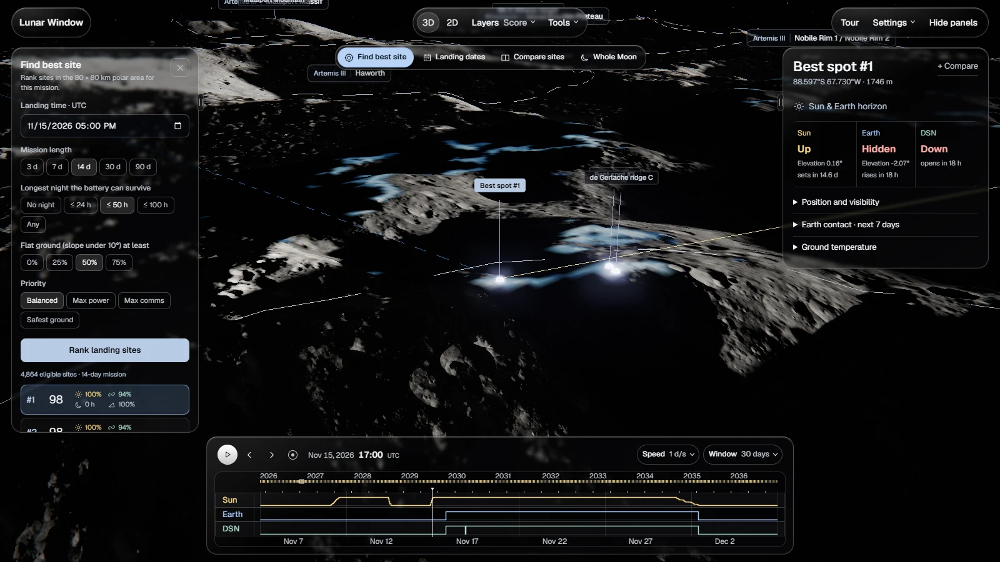

# Lunar Window

### Where and when to land at the Moon’s south pole

At the Moon's south pole, a ridge can get sunlight while the crater next to it stays dark. The same terrain can block a lander's view of Earth. Lunar Window lets you pick a site, move the clock and see when the Sun or Earth clears the skyline.

We built it for the 2026 NASA Space Apps Challenge. It's a prototype for comparing sites and dates, whether you're working through an early mission idea or teaching someone how lunar shadows move. [Lunar Landing Site Navigator challenge](https://www.spaceappschallenge.org/2026/challenges/lunar-landing-site-navigator/)

**[Open the live planner](https://adqm0001.github.io/lunar-window/)** · **[Seven-slide demo](docs/slides.pdf)** · [Editable slides](docs/slides.pptx) · [29-second video](docs/demo/lunar-window-29s.mp4) · [Project-page copy](docs/submission.md)


## Try a landing plan

1. Open the [planner](https://adqm0001.github.io/lunar-window/) and choose **Tour** for a nine-step introduction.
2. Select **Connecting ridge B**. Open **Sun & Earth horizon** to see which parts of their paths the terrain blocks.
3. Open **Find best site** and set the landing time in UTC. Set the mission length, how long the lander can go without sunlight and how much flat ground it needs. Click **Rank landing sites**.
4. Use **+ Compare** on a site, then **Add site** to select another. Compare their readings and the separate **Sun, Earth and DSN** timeline rows. **Side by side** opens two terrain views.
5. Open **Landing dates** to compare modeled battery endurance for different start times. Select a chart cell to inspect its date. **Whole Moon** returns to the overview.

On a phone, use the tabs at the bottom to switch between the map tools, site details and timeline. If the Moon is slow to move, try **Saver** or **Balanced** in Settings.

## Planning tools

| Tool | What it shows |
| --- | --- |
| **3D terrain and 2D map** | Inspect the surroundings, moving shadows and selected location. Add a custom point by coordinates or click the terrain. |
| **Sun and Earth horizon** | See their paths against the terrain skyline, with current elevations and visibility changes. |
| **Sunlight and communication layers** | Compare sunlight, Earth visibility, simultaneous power and DSN contact, longest night and slope over a selected period. |
| **Find best site** | Rank the loaded area by mission date, duration, night tolerance, flat ground and priorities. The default polar field has **102,400 grid locations**. |
| **Landing dates and comparison** | Compare start times for a chosen lander or place several sites on the same timeline. Green in Landing dates means the modeled battery lasts the requested mission. |
| **Lander simulation** | See how much power the panels produce and how much the lander uses each hour. A survival map and 4,000 simulated touchdowns show what can happen if the lander misses its target. |
| **Rover route planning** | Plan through sunlight and permitted slopes as shadows move, optionally require communication during movement, and replay the route. |
| **Temperature and ice stability** | See how hot the soil gets and where the model estimates it stays cold enough for ice to persist. |
| **Regional report and validation** | Compare NASA’s **October 2024 nine-region Artemis III candidate catalog**, analyze an area and inspect science checks. |
| **Sharing and presentation** | Share the time, site, layer and camera in a URL, take the guided tour or record the 3D canvas. |



*A spot can rank first for one mission and drop down the list if you change the date or the lander's power needs.*


*Earth can be in view even when none of the three Deep Space Network (DSN) stations can see the Moon. The timeline gives each of those conditions its own row.*

<details>
<summary>Phone layout and landing-date view</summary>

<p></p>


</details>

## NASA data and how it works

Python and C++ prepare the terrain and Sun and Earth positions offline. GitHub Pages serves the files, and your browser runs the calculations for the site and time you choose. You can open the app without an account.

For each point in the default polar grid, we store how high the skyline is in 180 directions. To work out whether a spot gets sunlight, the browser compares the Sun's elevation with the skyline in that direction. The polar 3D view uses the same skyline data for its shadows. NASA/JPL DE421 supplies hourly Sun and Earth positions from 2026 through 2036. Historical replays use their own dates.

For the contact estimates, the app also checks whether Goldstone, Madrid or Canberra can see the Moon. WebGL2 computes the area maps, and TypeScript handles site timelines, battery endurance and rover movement. The globe loads finer terrain tiles as you approach them.

Near the pole, NASA's elevation data reaches 40 m resolution. The default 80 × 80 km analysis area samples the horizon every 250 m. The surface can look more detailed up close because the view also uses interpolation and adds small rocks and craters for display.

| Data or reference | Use |
| --- | --- |
| [NASA LRO LOLA / PDS Geosciences Node](https://pds-geosciences.wustl.edu/missions/lro/lola.htm) | Polar and global elevation, meshes, skylines and slopes. |
| [NASA/JPL DE421 and NAIF kernels](https://naif.jpl.nasa.gov/pub/naif/generic_kernels/) | Sun/Earth geometry in the Moon-fixed frame, processed through Skyfield. |
| [NASA/JPL Horizons](https://ssd.jpl.nasa.gov/horizons/) | Independent reference service for checking positions. |
| [NASA Deep Space Network](https://www.nasa.gov/communicating-with-missions/dsn/) | Goldstone, Madrid and Canberra geometry for approximate contact windows. |
| [NASA SVS CGI Moon Kit](https://svs.gsfc.nasa.gov/4720/) | Surface color from LRO imagery, credited to NASA's Scientific Visualization Studio and the LRO Camera and LOLA teams. |
| [NASA's October 2024 region announcement](https://www.nasa.gov/news-release/nasa-provides-update-on-artemis-iii-moon-landing-regions/) and [IAU/USGS Gazetteer](https://planetarynames.wr.usgs.gov/) | Historical candidate names and feature locations. Circles in the app show approximate areas around those features. |
| [Bussey et al. (2010)](https://doi.org/10.1016/j.icarus.2010.03.028) | Published illumination derived from JAXA Kaguya topography, used as a comparison reference. We do not ingest Kaguya terrain directly. |
| [Hayne et al. (2017)](https://doi.org/10.1002/2017JE005387), Williams et al. (2017), Paige et al. (2010), Ingersoll et al. (1992) | Regolith properties, Diviner temperature comparisons, cold-trap context and approximate crater heating. [Full references](docs/sources.md). |

## Evidence and limits

Open **Validation** under **Tools** to see what we checked and where the estimates can differ.

| Check | Recorded result and scope |
| --- | --- |
| Sun and Earth positions against JPL Horizons | Largest reported elevation difference **0.00003°**, using daily samples at three sites through 2027. [Script](pipeline/validate_horizons.py). |
| Illumination against Bussey et al. | Mean absolute difference about **3.7 percentage points** across five peaks in 2020, after registering the locations to LOLA summits. [Script](pipeline/validate_illumination.py). |
| Thermal model against Diviner reference ranges | The panel compares model temperatures for Apollo 11 and the Shackleton floor with published Diviner measurements. |

- A predicted contact window tells you when the geometry allows a link. An operational link also needs an antenna and link budget check, plus an available station.
- Terrain resolution limits which slopes and hazards the app can resolve. The small rocks and craters added for the 3D view have no effect on calculations, and a site rank alone cannot establish landing safety.
- Battery results depend on the panel, power draw and reserve you choose. An ice estimate needs a year of data and tells you where ice could persist. Measuring how much ice is there takes other instruments.
- The heat model accounts for one bounce of light and heat from crater walls. Site and map models warm the soil up differently, so they can disagree over short periods.
- If you pick a time close to the end of the dataset, the app shortens the window or asks you to pick another date.

## Run locally

Use **Node.js 20 or newer** and a browser with **WebGL2**.

```bash
git clone https://github.com/adqm0001/lunar-window.git
cd lunar-window/web
npm ci
npm run dev
```

Open the address printed by Vite. Processed data is included in `web/public/data`.

Before a pull request:

```bash
npx tsc --noEmit -p .
npm test
npm run build
```

Rebuilding the offline pipeline requires Python 3, `pipeline/requirements.txt`, and a C++ compiler with OpenMP. See [ARCHITECTURE.md](ARCHITECTURE.md) for formats, coordinate frames and rebuilding guidance.

| Folder | Contents |
| --- | --- |
| `web/` | TypeScript, React, three.js, Zustand and WebGL2 planner, built with Vite. |
| `pipeline/` | Python data preparation, ephemerides and validation. |
| `engine/` | C++/OpenMP terrain-horizon calculations. |
| `docs/` | Slides, screenshots, submission copy, references and test reports. |

For contributions, read [CLAUDE.md](CLAUDE.md), [TASKS.md](TASKS.md) and [REVIEWING.md](REVIEWING.md). Changes go through checked pull requests. Merging to `main` deploys through GitHub Pages.

## Team

**Adam Benmoussa · Sazid Malik · Achraf Benchoubane · Mohammad Al-Qedra · Mohanad Abdelaal**

## SI assistance

We used OpenAI Codex/ChatGPT and Anthropic Claude to help write and review code, debug, test, explore interface ideas and draft documentation. Codex helped write this README and lay out the slides. The demo images are screenshots of the running app. The earlier design concepts used image generation.

The terrain and ephemeris files come from the NASA and JPL data we process in the pipeline. [SI disclosure](docs/si-disclosure.json) · [Source credits](docs/sources.md)

## Privacy

The app runs calculations in your browser, without an account or analytics. It can remember display settings and whether you've already seen the tour. Anyone with a link you share can see the view settings and custom coordinates it contains. Recordings save to your device.

GitHub Pages and external sites have their own logging and policies. See [GitHub’s privacy statement](https://docs.github.com/en/site-policy/privacy-policies/github-general-privacy-statement).

## Licensing

The team hasn't declared a license for its original code or documentation. Libraries, fonts and datasets have their own terms. [Source and license notes](docs/sources.md)

Lunar Window is an independent Space Apps entry. NASA and partner names identify the challenge and source material and do not imply affiliation or endorsement.
