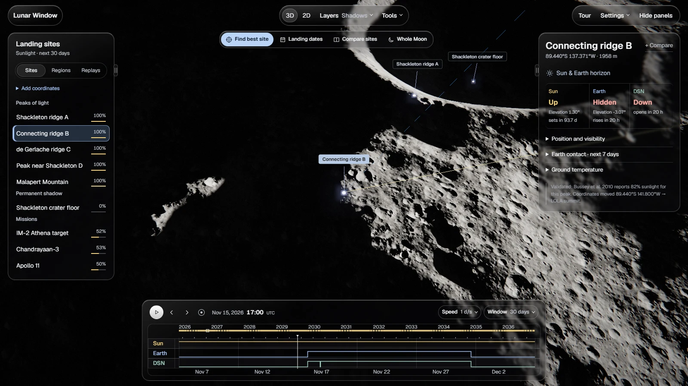
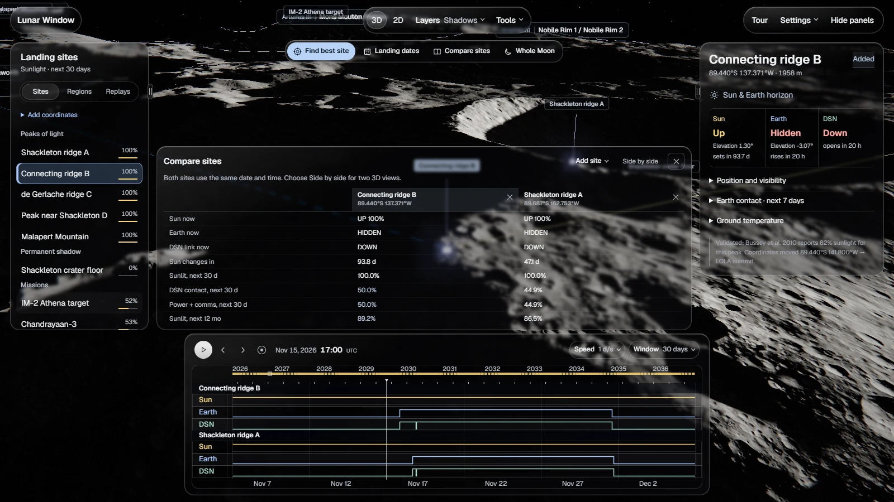
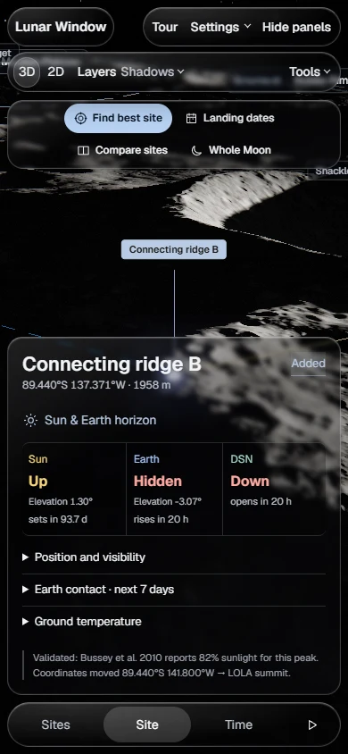
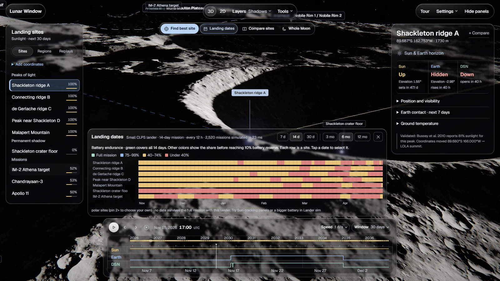

# Lunar Window

### Where and when to land at the Moon’s south pole

Lunar Window is an interactive lunar landing planner built for the **2026 NASA Space Apps Challenge: [Lunar Landing Site Navigator](https://www.spaceappschallenge.org/2026/challenges/lunar-landing-site-navigator/)**. Explore NASA lunar terrain, check whether the Sun and Earth clear a site’s skyline, and compare possible sites and landing dates in one browser window.

**[Open the live planner](https://adqm0001.github.io/lunar-window/)** · **[Seven-slide demo](docs/slides.pdf)** · [Editable slides](docs/slides.pptx) · [29-second video](docs/demo/lunar-window-29s.mp4) · [Project-page copy](docs/submission.md)



## Why this matters

Near the lunar south pole, a ridge can receive sunlight while a nearby crater floor stays in darkness. Terrain can also block Earth, interrupting direct communication. A location’s usefulness changes with the landing date and the mission’s power needs.

The challenge asks for a tool that makes these tradeoffs easy to evaluate. Lunar Window puts the terrain view, local horizon and time-dependent results together, so mission planners exploring early concepts, educators and the public can understand **why one site or date fits a mission better than another**.

This is an exploratory and educational prototype. Its rankings and simulations support comparisons, rather than certify a landing site or an operational mission.

## Try a mission in a few minutes

1. Open the [planner](https://adqm0001.github.io/lunar-window/) and choose **Tour** for a nine-step introduction.
2. Select **Connecting ridge B**. Open **Sun & Earth horizon** to see which parts of their paths the terrain blocks.
3. Choose **Find best site**, set the UTC landing time and mission length, then choose your night tolerance and flat-ground requirement. Select **Rank landing sites**.
4. Use **+ Compare** on a site, then **Add site** to select another. Compare their readings and the separate **Sun, Earth and DSN** timeline rows. **Side by side** opens two terrain views.
5. Open **Landing dates** to compare modeled battery endurance for different start times. Select a chart cell to inspect its date. **Whole Moon** returns to the overview.

On phones, the bottom navigation opens the same tools in sheets. Start with **Saver** or **Balanced** in Settings if the 3D view feels slow.

## What you can explore

| Tool | What it helps you decide |
| --- | --- |
| **3D terrain and 2D map** | Inspect the surroundings, moving shadows and selected location. Add a custom point by coordinates or click the terrain. |
| **Sun and Earth horizon** | See their paths against the terrain skyline, with current elevations and visibility changes. |
| **Sunlight and communication layers** | Compare sunlight, Earth visibility, simultaneous power and DSN contact, longest night and slope over a selected period. |
| **Find best site** | Rank the loaded area by mission date, duration, night tolerance, flat ground and priorities. The default polar field has **102,400 grid locations**. |
| **Landing dates and comparison** | Compare start times for a chosen lander or place several sites on the same timeline. Green in Landing dates means the modeled battery lasts the requested mission. |
| **Lander simulation** | Explore solar generation, loads and battery reserve hour by hour. A survival map and **4,000 simulated touchdowns** illustrate the effect of landing dispersion. |
| **Rover route planning** | Plan through sunlight and permitted slopes as shadows move, optionally require communication during movement, and replay the route. |
| **Temperature and ice stability** | Explore modeled soil temperatures and where the model permits ice to persist. These are estimates, not ice detections. |
| **Regional report and validation** | Compare NASA’s **October 2024 nine-region Artemis III candidate catalog**, analyze an area and inspect science checks. |
| **Sharing and presentation** | Share the time, site, layer and camera in a URL, take the guided tour or record the 3D canvas. |


*The finder ranks the loaded area for the chosen mission. A high score reflects those settings, not a universal “best” landing site.*



*Earth visibility and a DSN window are different conditions. Comparison keeps them visible alongside sunlight.*

<details>
<summary>Phone layout and landing-date view</summary>

<p></p>



</details>

## NASA data and how it works

The app ships processed data and runs its analysis in your browser. It has no application server or account requirement.

1. **Terrain:** NASA LRO LOLA elevation products supply measured topography. An offline C++ engine calculates terrain skylines for the polar grid and named sites.
2. **Geometry:** NASA/JPL DE421 ephemerides and lunar frame kernels supply hourly Sun and Earth positions. The main packaged dataset spans **2026–2036**. Historical replays have their own coverage.
3. **Visibility:** The browser compares a body’s elevation with the skyline. DSN windows also consider whether Goldstone, Madrid or Canberra can see the Moon.
4. **Models:** WebGL2 calculations produce area maps. TypeScript models evaluate site timelines, battery endurance and rover movement. The polar 3D view uses the same horizon field as the analysis.

**Measured terrain resolution and analysis spacing differ.** Source terrain reaches 40 m near the pole. The default 80 × 80 km analysis area uses 250 m horizon cells. Finer interpolated grids and visual detail do not add measured terrain information.

| Data or reference | Use |
| --- | --- |
| [NASA LRO LOLA / PDS Geosciences Node](https://pds-geosciences.wustl.edu/missions/lro/lola.htm) | Polar and global elevation, meshes, skylines and slopes. |
| [NASA/JPL DE421 and NAIF kernels](https://naif.jpl.nasa.gov/pub/naif/generic_kernels/) | Sun/Earth geometry in the Moon-fixed frame, processed through Skyfield. |
| [NASA/JPL Horizons](https://ssd.jpl.nasa.gov/horizons/) | Independent reference service for checking positions. |
| [NASA Deep Space Network](https://www.nasa.gov/communicating-with-missions/dsn/) | Goldstone, Madrid and Canberra geometry for approximate contact windows. |
| [NASA SVS CGI Moon Kit](https://svs.gsfc.nasa.gov/4720/) | Lunar surface color from LRO LROC imagery. Credit: NASA’s Scientific Visualization Studio, LRO Camera and LOLA teams. |
| [NASA’s October 2024 region announcement](https://www.nasa.gov/news-release/nasa-provides-update-on-artemis-iii-moon-landing-regions/) and [IAU/USGS Gazetteer](https://planetarynames.wr.usgs.gov/) | Historical candidate names and feature locations. Display circles are approximations, not official landing boundaries. |
| [Bussey et al. (2010)](https://doi.org/10.1016/j.icarus.2010.03.028) | Published illumination derived from JAXA Kaguya topography, used as a comparison reference. We do not ingest Kaguya terrain directly. |
| [Hayne et al. (2017)](https://doi.org/10.1002/2017JE005387), Williams et al. (2017), Paige et al. (2010), Ingersoll et al. (1992) | Regolith properties, Diviner temperature comparisons, cold-trap context and approximate crater heating. [Full references](docs/sources.md). |

## Evidence and limits

These are **recorded project validation results**, not a guarantee for every cell, year or device. **Tools → Validation** shows their context.

| Check | Recorded result and scope |
| --- | --- |
| Sun and Earth positions against JPL Horizons | Largest reported elevation difference **0.00003°**, using daily samples at three sites through 2027. [Script](pipeline/validate_horizons.py). |
| Illumination against Bussey et al. | Mean absolute difference about **3.7 percentage points** across five peaks in 2020, after registering the locations to LOLA summits. [Script](pipeline/validate_illumination.py). |
| Thermal model against Diviner reference ranges | The panel computes site estimates for Apollo 11 and Shackleton floor. This compares a model with published measurements, not a live Diviner feed. |

- **Visibility is geometry.** Earth or DSN visibility does not include a full RF link budget, antenna model, network allocation or operational availability.
- **“Flat” depends on resolution.** Slopes cannot reveal every rock or small crater. Procedural small craters and rocks are visual only.
- **Endurance depends on assumptions.** Landing dates and survival maps depend on the lander’s panel, load and reserve settings.
- **Ice stability is conditional.** A thermal threshold indicates where ice could persist under the model, not its abundance. An ice verdict needs a full year of data.
- **Heat flow is approximate.** Crater heating uses a single-bounce approximation. Site and GPU maps use different warm-up procedures, so short-period results can differ.
- **Coverage ends.** Tools shorten or reject windows beyond available data instead of treating missing hours as darkness.

## Run locally

Use **Node.js 20 or newer** and a browser with **WebGL2**.

```bash
git clone https://github.com/adqm0001/lunar-window.git
cd lunar-window/web
npm ci
npm run dev
```

Open the address printed by Vite. Processed data is included in `web/public/data`.

Before a pull request:

```bash
npx tsc --noEmit -p .
npm test
npm run build
```

Rebuilding the offline pipeline requires Python 3, `pipeline/requirements.txt`, and a C++ compiler with OpenMP. See [ARCHITECTURE.md](ARCHITECTURE.md) for formats, coordinate frames and rebuilding guidance.

| Folder | Contents |
| --- | --- |
| `web/` | TypeScript, React, three.js, Zustand and WebGL2 planner, built with Vite. |
| `pipeline/` | Python data preparation, ephemerides and validation. |
| `engine/` | C++/OpenMP terrain-horizon calculations. |
| `docs/` | Slides, screenshots, submission copy, references and test reports. |

For contributions, read [CLAUDE.md](CLAUDE.md), [TASKS.md](TASKS.md) and [REVIEWING.md](REVIEWING.md). Changes go through checked pull requests. Merging to `main` deploys through GitHub Pages.

## Team

**Adam Benmoussa · Sazid Malik · Achraf Benchoubane · Mohammad Al-Qedra · Mohanad Abdelaal**

## SI assistance

OpenAI Codex/ChatGPT and Anthropic Claude assisted with code, debugging, tests, reviews, interface exploration and documentation. This README and the refreshed slides also use SI-assisted writing and layout. Demo images capture the running app, rather than depict generated lunar photographs. Earlier generated design concepts are separate from these captures.

NASA observations remain the source data. Processed terrain and ephemerides come from the computational pipeline, rather than invented measurements. See [the SI disclosure](docs/si-disclosure.json) and [source credits](docs/sources.md). Confirm the disclosure against every team member’s tool use before submitting the official form.

## Privacy

The current app uses local browser computation and has no account system, application backend or analytics integration. Display preferences and tour state can persist in local storage. A shared URL contains view state and any included custom coordinates, which anyone with that link can read. Recordings download to your device.

GitHub Pages and external sites have their own logging and policies. See [GitHub’s privacy statement](https://docs.github.com/en/site-policy/privacy-policies/github-general-privacy-statement).

## Licensing

There is currently **no declared license for the repository’s original code or documentation**. Public source access does not itself grant an open-source license. Libraries, fonts and datasets retain their own terms and credits. See [source and license notes](docs/sources.md).

Lunar Window is an independent Space Apps entry. NASA and partner names identify the challenge and source material and do not imply affiliation or endorsement.
