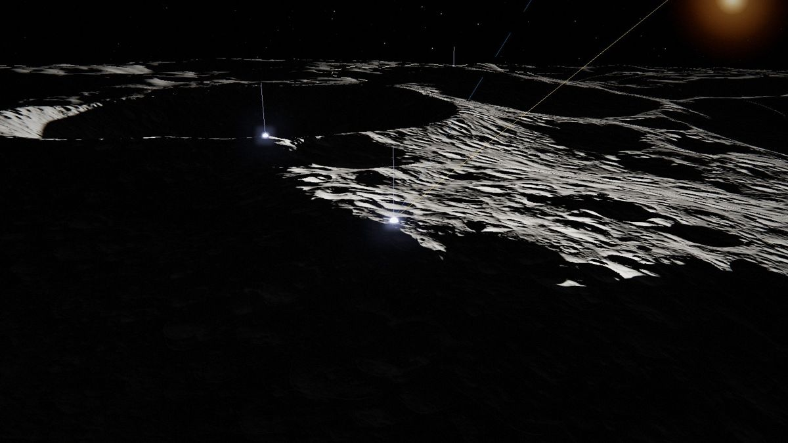
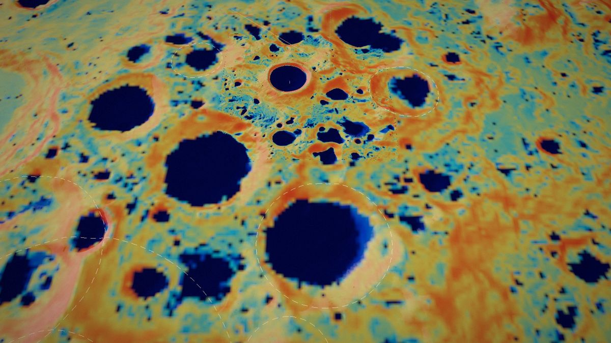
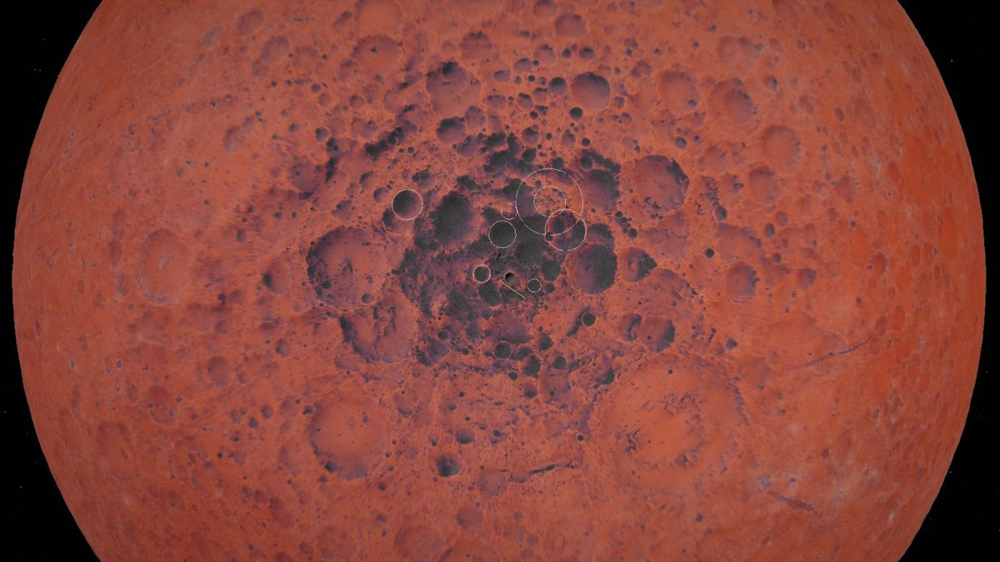
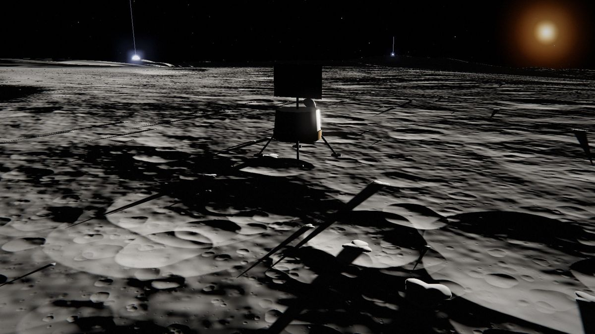
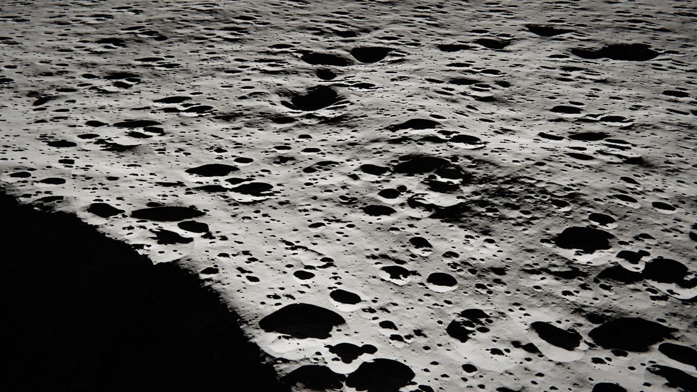

# Lunar Window

**Where and when to land at the Moon's south pole.**

A browser-based mission planner built for the NASA Space Apps Challenge 2026. It combines NASA's lunar terrain, the real positions of the Sun and Earth for every hour of 2026–2028, and physical models that run on your GPU to show sunlight, radio contact, surface temperature and water ice anywhere on the Moon.

**[Open the live app →](https://adqm0001.github.io/lunar-window/)**



---

## The problem

Artemis is going to the lunar south pole because its permanently shadowed craters hold water ice: drinking water, oxygen and rocket fuel for long missions. It is also the hardest place on the Moon to land.

- The Sun never rises more than about 1.6° above the horizon. Hills a few hundred metres tall cast shadows tens of kilometres long.
- Those shadows sweep around the landscape every 29.5 days, so a spot that is sunlit today can be dark tomorrow.
- A solar-powered lander that sets down in the wrong place, or at the wrong time, runs out of power and freezes.
- Earth dips behind the terrain too, cutting off direct radio contact.

Mission planners have to answer two questions at once: **where** is there light, contact with Earth and safe ground, and **when**?

## What it does

| | |
|---|---|
| **3D Moon** | The whole Moon from NASA LOLA elevation data, from orbit down to 40 m terrain at the pole, lit by the real Sun at any hour. Every shadow is computed from the actual terrain horizon. |
| **Sunlight, Earth and DSN maps** | Share of time each point sees the Sun, sees Earth, and has a Deep Space Network dish in view, plus the longest night, for any date range. |
| **Temperature and water ice** | A heat-flow model of the lunar soil runs for every point and shows where water ice stays stable at or below the surface. |
| **Landing spot finder** | Choose a landing date, mission length, longest night your battery can survive and the flat ground you need. It scores 102,400 spots and returns the top 10. |
| **Lander simulator** | Solar panels, battery and power loads simulated hour by hour at a site, or across the whole area as a survival map. |
| **Landing-miss Monte Carlo** | 10,000 simulated touchdowns around a target to estimate the odds of ending up on safe, sunlit ground. |
| **Rover route planner** | Finds a route that keeps a solar rover in sunlight on drivable slopes as the shadows move, waiting out darkness when it has to, then animates the drive. |
| **Artemis III report card** | Ranks NASA's nine candidate landing regions for your dates by sunlight, Earth contact, longest night and nearby ice. |
| **Site details** | Countdown to the next sunset and Earth-set, the next week of DSN contact windows, ground temperature through the year, and a skyline view showing the paths of the Sun and Earth over the terrain. |
| **Validation** | A built-in panel that compares the results against NASA JPL Horizons, published research and NASA's Diviner instrument. |
| **Sharing** | Links that reopen the exact view (time, site, layer, camera), video recording of the 3D view and a one-minute guided tour. |

<table>
  <tr>
    <td></td>
    <td></td>
  </tr>
  <tr>
    <td align="center"><sub>Maximum surface temperature: permanently shadowed craters in deep blue</sub></td>
    <td align="center"><sub>Share of the year in sunlight across the south polar region</sub></td>
  </tr>
  <tr>
    <td></td>
    <td></td>
  </tr>
  <tr>
    <td align="center"><sub>A lander at true scale on the connecting ridge near Shackleton</sub></td>
    <td align="center"><sub>Crater shadows with the Sun 8° above the horizon</sub></td>
  </tr>
</table>

## How we know it's right

| Check | Result |
|---|---|
| Sun and Earth positions vs. NASA JPL Horizons (3 sites, one year) | agree to **0.00003°** |
| Sunlight at the five "peaks of light" vs. Bussey et al. 2010 | within **3.7 percentage points** on average |
| Equatorial temperature (Apollo 11 site) vs. NASA Diviner | **86–385 K** modelled, about 95–390 K measured |
| Shackleton crater floor | below 110 K all year: a cold trap where ice is stable |

The validation panel in the app recomputes several of these live. Its limits are stated openly too: the terrain is only as sharp as the LOLA data (40 m near the pole), small craters and rocks shown up close are for looks only, and the thermal model leaves out light reflected from nearby slopes.

## How it works

```
NASA LOLA terrain ─┐
                   ├─► C++ horizon engine (OpenMP) ─► horizon field: 102,400 points × 180 directions
JPL DE421 ephemeris ┤
                   └─► Sun / Earth / DSN positions, hourly 2026–2028
                                       │
                                       ▼
            Browser (WebGL2): sunlight, contact, night, heat flow, routes, rendering
```

- **Horizons.** For every grid point, rays are marched outward across the terrain in every direction, accounting for the Moon's curvature, to find how high the skyline is. The Sun is visible when it stands above that skyline. The C++ engine does about 6 billion terrain lookups for the polar area in roughly a minute on 8 cores.
- **Whole Moon on the GPU.** In the browser, horizons for 2.2 million more points are computed on the GPU in under a second, so every map also covers the whole Moon.
- **Time series on the GPU.** Each map steps through thousands of hours for every point in parallel. A year of sunlight for the polar area takes milliseconds; a year of soil temperature for the whole Moon takes about a second and a half.
- **Rendering.** three.js with custom shaders. A quadtree level-of-detail sphere streams terrain tiles, and every pixel looks up its own horizon toward the Sun, so the shadows on screen are the same physics as the numbers in the panels.

## Data

| Source | Use |
|---|---|
| NASA LRO LOLA gridded elevation (40 m, 80 m and 240 m polar; 64 and 16 pixels/degree global) | terrain, horizons, slopes |
| NASA/JPL DE421 ephemeris and Moon frame kernels (via Skyfield) | Sun and Earth positions |
| Deep Space Network station locations | radio contact windows |
| NASA SVS CGI Moon Kit (LRO LROC) | surface color |
| Hayne et al. 2017; Williams et al. 2017; Paige et al. 2010 | regolith properties and temperature checks |
| Bussey et al. 2010 | sunlight checks at polar peaks |
| NASA Artemis III candidate regions (2024), IAU feature centers | region outlines |

## Running it locally

The app needs Node 20+ and a browser with WebGL2.

```bash
cd web
npm install
npm run dev
```

The processed data the app loads is already in `web/public/data`. To rebuild it from the original NASA files you need Python 3 and a C++ compiler with OpenMP (g++):

```bash
cd pipeline
pip install -r requirements.txt
python fetch_data.py          # downloads LOLA terrain and SPICE kernels
python ephemeris.py           # Sun and Earth positions, DSN visibility
python build_sites.py         # horizons for named sites
python build_field.py         # polar horizon field, heights, slopes
python build_globe.py         # global and polar terrain for the 3D Moon
python build_tiles.py         # 40 m polar terrain tiles
python build_global_tiles.py  # 64 pixels/degree global terrain tiles
python validate_illumination.py
python validate_horizons.py
```

## Project layout

```
engine/      C++ horizon ray-caster
pipeline/    Python: data download, ephemeris, horizon fields, validation
web/         TypeScript + React + three.js app
  src/gpu/       GPU engines: sunlight, heat flow, whole Moon, rover visibility
  src/three/     3D scene, terrain level of detail, shaders
  src/lib/       astronomy, lander and rover models, thermal model
  src/components UI panels
docs/        screenshots for this page
```

## Contributing

The list of open work, with details for each task, is in **[TASKS.md](TASKS.md)**. Pick one, put your name on it, and go.

1. Fork the repo (or create a branch if you've been added as a collaborator).
2. Run the app locally (see above) and make your change on a branch named after the task, for example `thermal-bounced-light`.
3. Check that the build passes before opening a pull request:
   ```bash
   cd web
   npm run build
   ```
4. Open a pull request against `main` describing what changed and how you tested it. Screenshots help for anything visual.

Commit messages are short, plain descriptions of what the commit does. Every merge into `main` redeploys the live site automatically through GitHub Actions (`.github/workflows/pages.yml`), so please keep `main` working.

## Built with

C++ (OpenMP) · Python (NumPy, Skyfield, Pillow) · TypeScript · React · three.js · WebGL2 · Vite

---

NASA data used here is in the public domain. Lunar Window is not affiliated with or endorsed by NASA.
