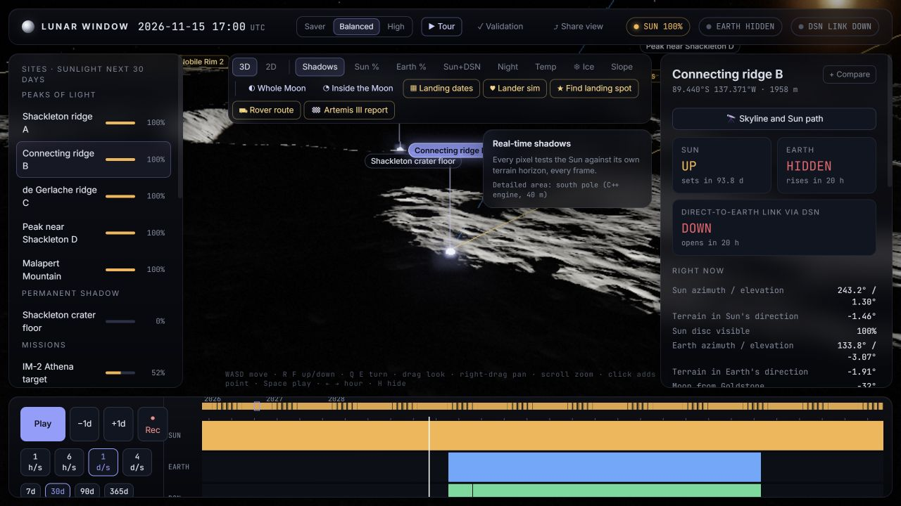
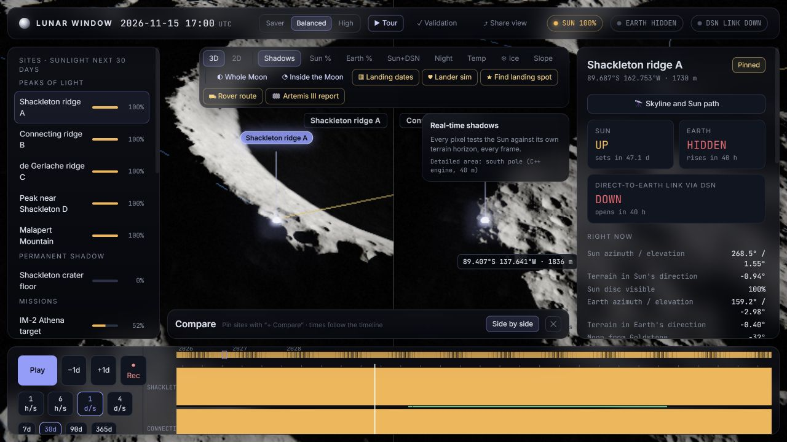

# Touch camera frame pacing

Camera input improvement related to [issue #143](https://github.com/adqm0001/lunar-window/issues/143). The original iPhone Safari report stays open until this change has been checked on the affected real device.

## Reproduced behavior

The installed OrbitControls advances damping inside pointer handlers as well as in the animation loop. In a Node input-surface regression test, a 200-pixel touch drag delivered in one event and the same drag delivered in 20 events produce different camera positions at the next animation frame. Six of the seven camera tests fail with stock OrbitControls and pass with the frame-driven controls.

`FrameOrbitControls` retains the input deltas until the animation loop applies them. Damping decay uses elapsed time, preserving the existing 0.07 factor at 60 Hz and giving equivalent settling at 30, 60 and 120 Hz. Both split-screen views use the same control class. Input does not add GPU work or change the 2D map's separate pointer handling.

This confirms an event-delivery-dependent camera behavior; it does not prove that it is the only cause of the reported iPhone lag or jumps. Site-loading delays are not addressed by this change.

## High-refresh screens

Elapsed-time damping gives the glide the same duration across refresh rates. In the [independent desktop review](https://github.com/adqm0001/lunar-window/pull/145#pullrequestreview-5912455543), a display running around 170 FPS settled in about 0.9 seconds with this change, compared with about 0.35 seconds on main. The longer glide at high refresh is intentional; the decay rate matches the existing 60 Hz behavior. This measurement was from desktop Chromium, not a phone.

## Verification

- `npx tsc --noEmit -p .`: passed.
- `npm test`: all 315 tests in 37 files passed on source `7584d17`, including seven camera input regressions covering burst delivery, elapsed-time damping, pinch/pan, cancellation, mouse drag/wheel, independent cameras and input-listener disposal.
- Repeated the seven camera tests against stock OrbitControls with a frame-update adapter: six failed and one passed. Restored the candidate exactly before running the full passing suite.
- `npm run build`: passed, with the existing three.js chunk-size warning.
- Initial desktop Chromium smoke test on the development build: loaded terrain, dragged the 3D camera, switched sites, entered 2D, panned and returned to 3D, then dragged the left and right split views independently. No console warnings or errors were captured during that check. The linked independent review also checked drag, zoom, keyboard movement, site flights, 2D return and independent split cameras after integration with main.

## Required iPhone recheck

Open the current candidate build in Safari and wait for terrain loading to finish. In 3D, drag slowly, drag quickly in both directions, lift and drag again, then pinch. Repeat after selecting another site and after switching to 2D and returning to 3D. Compare with the deployed upstream app. Check that movement follows the gesture without the reported jumps, and that 2D pan/pinch and panels still work. Record any remaining lag or jumps before treating the original issue as resolved.

Status: awaiting the tester's result. Desktop testing and Node input events do not substitute for Safari on a real iPhone.

[Historical preview of the initial candidate](https://raw.githack.com/hanoudee/lunar-window/e6a28b9cb96ee61624849ba9de8dfb98f1d89a30/index.html), built from source commit `71323f0`. It predates the main-branch integration at `7584d17`. Its isolated HTML uses anonymous CORS for CDN-hosted images; that hosting adjustment is not part of the application change in this PR. Future phone verification should use the current candidate source.
