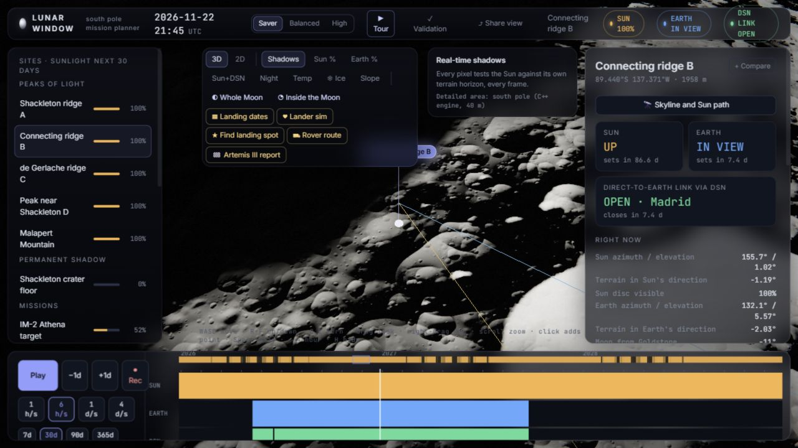
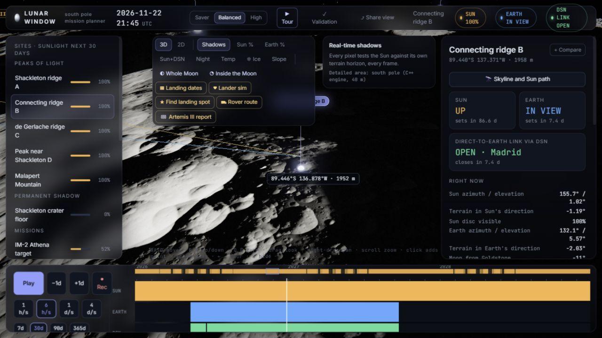
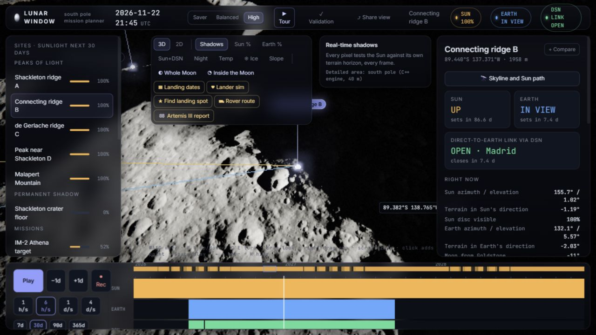
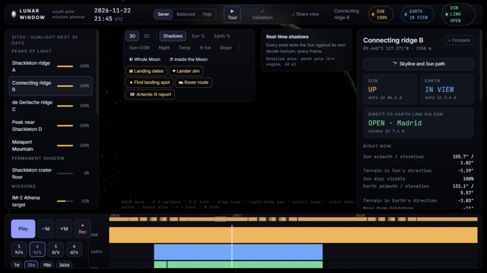

# Task 12: Integrated-graphics laptop

Tested on 2026-11-15 for [issue #37](https://github.com/adqm0001/lunar-window/issues/37).

All three quality modes render and accept camera/playback input on this laptop. High has substantial frame-pacing problems in the local development measurements below. Completing the device test does not mean that High is smooth or that a performance fix has been implemented.

## Environment

- ASUS Zenbook UX3402VA, Intel Core i7-1360P, 16 GB RAM.
- Windows 11 Home, build 26200; Intel Iris Xe driver 32.0.101.7088.
- ChatGPT in-app Chromium, user agent Chrome/157.0.0.0. Standalone Google Chrome was not successfully connected and is not covered by this report.
- WebGL2 renderer: `ANGLE (Intel, Intel(R) Iris(R) Xe Graphics (0x0000A7A0) Direct3D11 vs_5_0 ps_5_0, D3D11)`. This was the laptop's Intel GPU, not a software renderer.
- Measurements: 1280 x 720 CSS viewport, native device pixel ratio 2; normal adaptive resolution stayed enabled. Every sample ended at rendering ratio 0.6 with a 768 x 432 WebGL canvas.
- Local source: `78f37320cfc21c6e4ad816a0fb5a06e707689d7d`; Node 26.13.1, npm 11.20.0, dependencies installed with `npm ci`.
- Deployed smoke test: [live app](https://adqm0001.github.io/lunar-window/), same device/browser, desktop viewport fixed at 1280 x 720 for the comparison and restored afterwards. Its deployment SHA was not independently verified.

## Procedure and observed behavior

1. Open the live app at Connecting ridge B, Shadows layer, and allow the terrain to load.
2. Select Saver, choose 6 h/s, and play. Repeat with Balanced and High. The selected quality changes and the UTC time, terrain illumination, site values and timeline continue updating in each mode.
3. Pause and drag the terrain in each mode. The camera changes position and the terrain is redrawn in all three modes.
4. Select Whole Moon. The flight completes and the globe renders. Restore Balanced and pause playback at the end.
5. Inspect captured browser console output. No warnings or errors were captured during these deployed-site checks.
6. Run the local development app, wait for the 80 m polar terrain, and compare actual scene render intervals during 6 h/s playback at the initial Connecting ridge B surface camera. Repeat Balanced after adaptive resolution settles and repeat High to check the long gaps.

The local probe wrapped `window.__scene.composer.render`, recorded one `performance.now()` timestamp per call, and delegated immediately to the original function. It did not manually step the render loop, force additional renders, change quality settings internally, or disable adaptive resolution. Each requested sample lasted ten seconds; timer delays extended two samples slightly. FPS is actual render calls divided by elapsed wall time. The interval statistics describe scene render pacing, not GPU timer-query durations or the browser's requestAnimationFrame callback rate. The sample tab stayed visible throughout every measurement.

The simulated date kept advancing between samples, so these are observations of this setup, not a controlled ranking at an identical Sun angle. Screenshot capture and browser automation can also affect performance. Battery/AC and thermal state were not controlled, and results should not be generalized to other integrated GPUs.

## Local frame-pacing results

| Sample | Quality | Duration (s) | Rendered FPS | Median gap (ms) | p95 gap (ms) | Largest gap (ms) | Rendering ratio start → end |
|---|---|---:|---:|---:|---:|---:|---|
| 1 | Saver | 10.009 | 28.4 | 32.7 | 50.4 | 504.6 | 0.75 → 0.6 |
| 2 | Balanced, transition | 10.543 | 23.7 | 26.1 | 120.5 | 472.7 | 1.25 → 0.6 |
| 3 | Balanced, settled | 10.009 | 34.8 | 28.1 | 35.9 | 131.7 | 0.6 → 0.6 |
| 4 | High | 10.009 | 6.8 | 38.2 | 452.4 | 1140.7 | 0.6 → 0.6 |
| 5 | High, repeat | 10.405 | 11.1 | 28.0 | 378.1 | 505.1 | 0.6 → 0.6 |

[Recorded sample data](task-12-samples.json) includes frame intervals, canvas size, camera, start/end ephemeris hours and visibility flags. Percentiles use the sorted interval at index `floor((length - 1) * p)`.

Saver stays near its 30 FPS cap most of the time but still has occasional long gaps. Balanced improves after adaptive resolution drops. High has repeated long pauses even at the minimum rendering ratio; it should not be described as smooth on this setup. Exact production FPS was not measured, and the cause of the local stalls has not been isolated. This finding is recorded here for follow-up; a separate performance issue has not been filed.

The local probe captured no uncaught errors or unhandled rejections. Development console output contained shader compiler warnings X3577 (`isnan` optimization) and X4000 (potentially uninitialized `f_demH`), without a reported shader compilation failure. These warnings were not present in the captured deployed-site console output.

## Screenshots

These paused screenshots establish the selected mode and rendered view; a static image cannot establish smooth frame pacing. The camera was dragged between screenshots, so they are not image-quality comparisons at an identical camera.

| Saver | Balanced | High |
|---|---|---|
|  |  |  |



## Repository checks

The following passed locally with the temporary instrumentation removed from the tracked app:

```text
cd web
npx tsc --noEmit -p .
npm test                 # 4 files, 60 tests
npm run build
```

Vite emits its existing warning about the three.js chunk exceeding 500 kB. There are no application source or dependency changes in this task. Temporary probes and local notes are excluded from Git.
