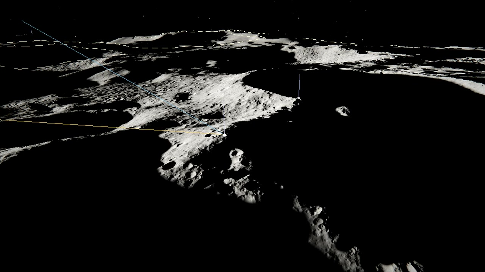

# Moving polar shadows

Submission clip for [Task 2 / issue #27](https://github.com/adqm0001/lunar-window/issues/27).

[Download or play the WebM](task-2-moving-shadows.webm)

## Clip

- Duration: **15.000 seconds**.
- Format: WebM, VP9, 1280 × 720, constant 30 FPS, 450 frames; no audio.
- Content: fixed surface view near Connecting ridge B at the lunar south pole, with terrain shadows moving as the Sun's direction changes.
- Source: the [live app](https://adqm0001.github.io/lunar-window/), Shadows layer, Saver quality, **6 h/s** playback, recorded with the timeline's **● Rec** button on 2026-11-15.
- Starting simulated time: approximately 2026-11-26 08:54 UTC. At the selected speed, the clip spans approximately 90 simulated hours.
- Camera: target latitude/longitude `-89.45, -140`; camera latitude/longitude/altitude `-88.9607, -140, 7.095 km`. The camera stayed fixed during recording.

The built-in recorder captures the WebGL canvas without the surrounding panels. The take ran longer than intended because of browser-control latency; the delivered clip uses its first 15 seconds. Adaptive rendering changed the source frame dimensions, so the export scales frames to a consistent 720p size and resamples their timestamps to constant 30 FPS. This does not speed up the recorded simulation or imply that every source frame was rendered at 30 FPS. The app's direction rays remain visible.

## Verification

- Decoded the entire final WebM with FFmpeg's `-xerror` option: no decode errors.
- Confirmed duration 15.000 seconds, VP9 video, 1280 × 720, 30 FPS and 450 decoded frames.
- Inspected frames at the beginning, middle and end: terrain remains framed consistently and illuminated/shadowed areas change visibly.
- Checked browser playback, seeking to 7.5 and 14.8 seconds, and completion at 15 seconds without a media error.
- Ran `npx tsc --noEmit -p .`, `npm test` (60 tests) and `npm run build` from `web/`. All passed; Vite reports the existing large three.js chunk warning.

Only this clip, its preview/documentation and Task 2's checkbox are included. There are no application or dependency changes. The longer take, temporary FFmpeg installation and local verification page remain outside Git in `notes/`.
