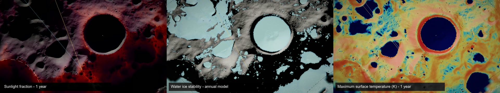

# Sunlight, ice and temperature layers

Submission clip for [Task 3 / issue #28](https://github.com/adqm0001/lunar-window/issues/28).

[Download or play the WebM](task-3-layers.webm)

## Sequence

| Time | Layer | Range |
|---|---|---|
| 0–5 s | Sun %: fraction of time the Sun is visible | 1 year |
| 5–10 s | Ice: modelled water-ice stability | Full annual thermal model |
| 10–15 s | Temp: maximum surface temperature, kelvin | 1 year |

The clip is **15.000 seconds**, VP9/WebM, 1280 × 720, constant 30 FPS (450 frames), without audio. Each section includes a caption naming the layer. The preview shows frames at 2.5, 7.5 and 12.5 seconds.

## Capture

Recorded on 2026-11-15 from the [live app](https://adqm0001.github.io/lunar-window/), with its built-in **● Rec** control. The **1y** range and completed GPU calculations were checked before recording. Sun and Ice start with the annual window 2026-01-02 → 2027-01-02; Temp starts with 2026-01-03 → 2027-01-03. Playback was set to 1 h/s, so the first five seconds of each take stay within that starting day and annual window.

All sections use the default palette, Saver quality and the same fixed polar camera: target `-89.8°, -140°`, camera `-89.65°, -140°`, altitude approximately 60 km. The built-in recorder captures the WebGL canvas, without the surrounding panels or their legends; the app's direction rays remain visible.

The first five seconds of each take were trimmed, scaled to a consistent 720p size, captioned and joined in the specified Sun → Ice → Temp order. The 30 FPS export resamples source frames without changing playback speed; it is not a claim about native rendering performance. No model values, palette colors or application code were changed. The existing thermal model limitations described in the app still apply.

## Verification

- Confirmed the Sun % layer's **1y** range and annual date interval in the live UI.
- Confirmed completed polar and whole-Moon GPU results for each layer before capture; no console errors were captured.
- Decoded the entire final WebM using FFmpeg with `-xerror`: no errors; 15.000 seconds, 1280 × 720, 30 FPS and 450 decoded frames.
- Inspected the actual exported frames at 2.5, 7.5 and 12.5 seconds to confirm distinct layers, readable captions and consistent framing.
- Played the finished video to completion in a browser and checked seeking into Ice and Temperature without media errors.
- Ran `npx tsc --noEmit -p .`, `npm test` (60 tests) and `npm run build` from `web/`; all passed, with the existing Vite warning about the large three.js chunk.

Only Task 3's clip, preview, documentation and checkbox are included. Original takes, temporary fonts/tools and the local verification page remain excluded under `notes/`.
