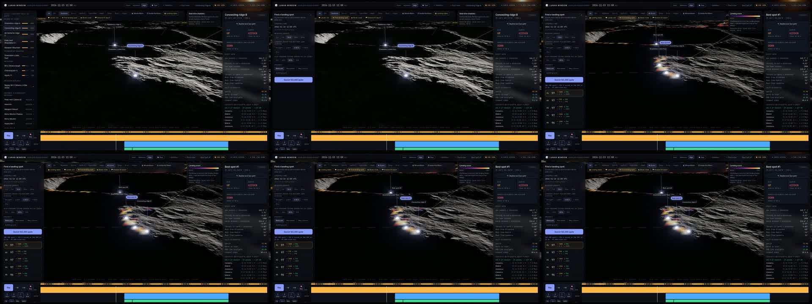

# Landing finder

Submission clip for [Task 4 / issue #29](https://github.com/adqm0001/lunar-window/issues/29).

[Download or play the WebM](task-4-landing-finder.webm)

## Sequence

| Time | What happens |
|---|---|
| 0–1.7 s | Connecting ridge B selected, site list on the left |
| 1.7 s | ★ Find landing spot opens the finder panel (14 d mission, night ≤ 50 h, flat ground ≥ 50 %, Balanced) |
| 5.1 s | Search 102,400 spots: "102,400 spots × 336 h scored on the GPU in 13 ms · 97,308 ruled out" |
| 5.1–6.8 s | The Score layer turns on, result #1 (score 97, ☀ 100 %, ⇅ 92 %, ☾ 0 h, ▱ 100 %) is selected and the camera flies to it |
| 6.8–10.5 s | Held on Best spot #1 with the ranked results and its site panel |

The clip is **10.500 seconds**, VP9/WebM, 1920 × 1080, constant 30 FPS (315 frames), without audio. It shows the full page: panels, header, timeline and the 3D view.

## Capture

Recorded on 2026-11-15 from the [live app](https://adqm0001.github.io/lunar-window/) (main at 13d45a9) in Firefox 160 on Linux, High quality, with the page at 1920 × 1080. The app's ● Rec only captures the WebGL canvas, so the browser window was screen-recorded with FFmpeg (`x11grab`, 30 FPS, lossless), cropped to the page and encoded to VP9 (CRF 30). The mouse pointer is not drawn. The landing time is the app's default, 2026-11-15 11:00 UTC.

Search already selects result #1 and flies the camera to it, so the spec's "click result #1" has no visible effect. It was clicked at about 8 s in the take and nothing changes. The spec in TASKS.md now describes this.

## Verification

- Decoded the entire WebM with FFmpeg's `-xerror` option: no decode errors. 315 frames, 1920 × 1080, 30 FPS, 10.500 seconds.
- Measured frame-to-frame differences of the take: the panel opens at 1.7 s and the camera flight runs from 5.1 s to 6.8 s; the rest is still.
- Inspected frames at 0.5, 2.5, 5.5, 6.5, 7.5 and 10 seconds for the panel, results list, Score layer and selection.
- Played it to the end in Firefox with no media error, and seeked to 2.5, 6.0 and 10.4 seconds.
- Ran `npx tsc --noEmit -p .`, `npm test` (81 tests) and `npm run build` from `web/`. All passed.
