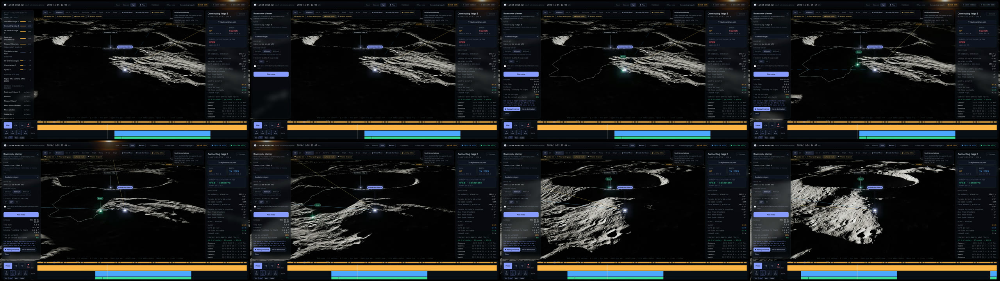

# Rover route

Submission clip for [Task 5 / issue #30](https://github.com/adqm0001/lunar-window/issues/30).

[Download or play the WebM](task-5-rover.webm)

## Sequence

| Time | What happens |
|---|---|
| 0–1.7 s | Connecting ridge B selected, site list on the left |
| 1.7 s | ⛟ Rover route opens the planner: from Connecting ridge B to Shackleton ridge A, leaving 2026-11-15 12:00 UTC, 400 m/h, 20° slope limit |
| 5.1 s | Plan route draws the route: arrives 2026-11-24 11:37, 9.0 d trip, 25.1 km, 2.6 d driving / 6.4 d waiting for light, 100 % in sunlight, 85 % in contact with Earth |
| 9.1 s | ▶ Replay the drive plays the timeline at 6 h/s. The rover marker follows the route while the shadows move. |
| about 45 s | The rover reaches Shackleton ridge A |
| 45–47.5 s | Held after arrival |

The clip is **47.500 seconds**, VP9/WebM, 1920 × 1080, constant 30 FPS (1,425 frames), without audio. It shows the full page: panels, header, timeline and the 3D view. The replay takes most of the clip (216 simulated hours at 6 h/s), so the edit can speed it up.

## Capture

Recorded on 2026-11-15 from the [live app](https://adqm0001.github.io/lunar-window/) (main at 13d45a9) in Firefox 160 on Linux, High quality, with the page at 1920 × 1080. Before recording, the camera was zoomed out from 5.2 km to 6.8 km so the whole route fits beside the panels. Otherwise all settings are the app's defaults. Shackleton ridge A is the planner's default destination. The app's ● Rec only captures the WebGL canvas, so the browser window was screen-recorded with FFmpeg (`x11grab`, 30 FPS, lossless), cropped to the page and encoded to VP9 (CRF 30). The mouse pointer is not drawn.

## Verification

- Decoded the entire WebM with FFmpeg's `-xerror` option: no decode errors. 1,425 frames, 1920 × 1080, 30 FPS, 47.500 seconds.
- Measured frame-to-frame differences of the take. The panel opens at 1.7 s and the route appears at 5.1 s. From the replay to the end, the picture changes on every frame, so the replay plays smoothly at 30 FPS.
- Inspected frames at 0.5, 2.5, 6, 12, 20, 28, 36 and 45.5 seconds for the panel, the route, the moving rover and its arrival at Shackleton ridge A. The planner showed "Arrived" during the take.
- Played it to the end in Firefox with no media error, and seeked to 6, 28 and 47.4 seconds.
- Ran `npx tsc --noEmit -p .`, `npm test` (81 tests) and `npm run build` from `web/`. All passed.
