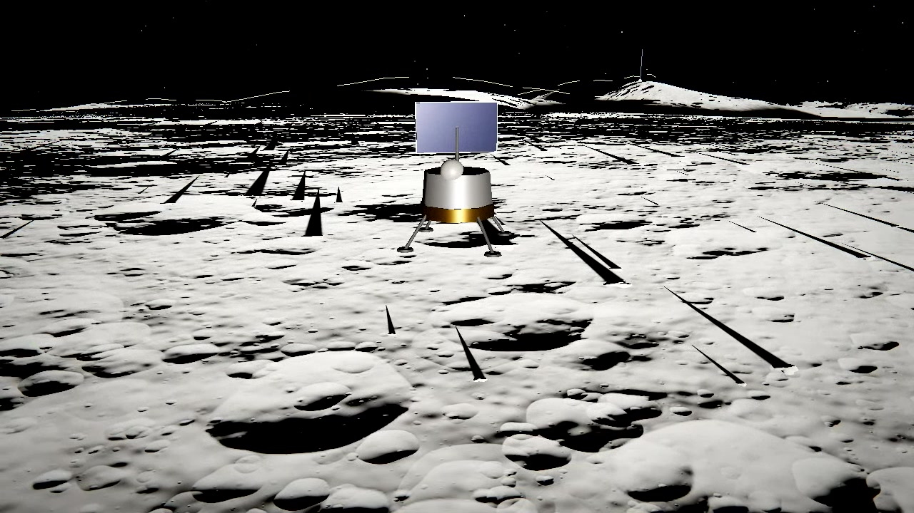

# Lander close-up orbit

Submission clip for [Task 6 / issue #31](https://github.com/adqm0001/lunar-window/issues/31).

[Download or play the WebM](task-6-lander.webm)

## Clip

- Duration: **14.966 seconds** (approximately 15 seconds).
- Format: VP9/WebM, 1280 × 720, constant 30 FPS, 449 decoded frames; no audio.
- View: a slow orbit around the app's lander at Connecting ridge B, with the vehicle kept centered against the polar terrain.
- Setup: **♥ Lander sim → See the lander on the ground**, default small-lander settings, Shadows layer, Saver quality.
- Simulated time: approximately 2026-11-15 05:27 UTC. Timeline playback was paused during the orbit to keep the lighting steady.

## Capture and export

Recorded on 2026-11-15 from the local development app at source revision `78f37320cfc21c6e4ad816a0fb5a06e707689d7d`, using the timeline's built-in **● Rec** control. It captures the WebGL canvas without the surrounding panels.

A temporary local control enabled three.js `OrbitControls.autoRotate` with `autoRotateSpeed = 0.35` for steady camera motion. It changes only the capture camera; the app's existing lander geometry, scale, terrain and lighting are used. The helper was removed from the tracked app before running the project checks and is excluded from Git.

The longer take was trimmed to its first approximately 15 seconds, normalized to 720p and resampled to constant 30 FPS without changing playback speed. Output FPS is not a claim about native rendering performance. The preview is extracted at 7.5 seconds.

## Verification

- Used the lander simulator's **See the lander on the ground** control and confirmed the close-up before recording.
- Inspected exported frames at the beginning, 7.5 seconds and 14.5 seconds: the lander remains centered while the camera angle and terrain perspective change.
- Decoded the entire final WebM with FFmpeg's `-xerror` option: no errors; 1280 × 720, 30 FPS, 449 frames and duration 14.966 seconds.
- Checked browser playback to completion and seeking to the middle and near the end without media errors.
- No browser console errors were captured during the recording setup.
- With the temporary helper removed and the branch updated to main revision `13d45a9`, ran `npx tsc --noEmit -p .`, `npm test` (81 tests) and `npm run build` from `web/`. All passed; Vite emits its existing large three.js chunk warning.

This task contains the clip, preview, capture notes and Task 6 checkbox only. Original footage and temporary capture/verification tools remain excluded under `notes/` or local Git excludes.
