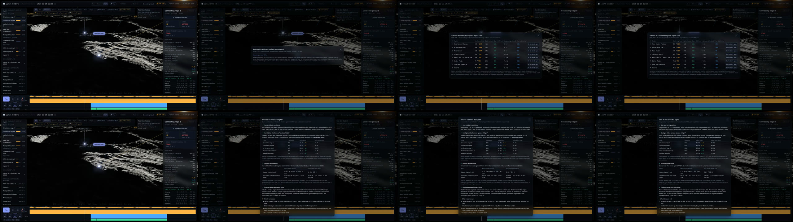

# Artemis III report and validation

Submission clip for [Task 7 / issue #32](https://github.com/adqm0001/lunar-window/issues/32).

[Download or play the WebM](task-7-report-validation.webm)

## Sequence

| Time | What happens |
|---|---|
| 0–1.7 s | Connecting ridge B selected |
| 1.7 s | 🏁 Artemis III report opens and computes |
| 2.8–10.8 s | The report card: NASA's nine candidate regions in eight ranked rows (Nobile Rim 1 and 2 share one) with sunlight, Earth in view, Sun + DSN, longest night and ice-stable area, for 2026-11-15 + 30 days |
| 10.8 s | The report closes |
| 13.3–24 s | ✓ Validation: "How do we know it's right?", covering Sun and Earth positions against JPL Horizons, the peaks of light against Bussey et al. 2010, ground temperature against Diviner, engine agreement and what the model leaves out |

The clip is **24.000 seconds**, VP9/WebM, 1920 × 1080, constant 30 FPS (720 frames), without audio. It shows the full page. The Validation window fits on screen at this size, so there is no scrolling.

## Capture

Recorded on 2026-11-15 from the [live app](https://adqm0001.github.io/lunar-window/) (main at 13d45a9) in Firefox 160 on Linux, High quality, with the page at 1920 × 1080 and the app's default view and time. The app's ● Rec only captures the WebGL canvas, so the browser window was screen-recorded with FFmpeg (`x11grab`, 30 FPS, lossless), cropped to the page and encoded to VP9 (CRF 30). The mouse pointer is not drawn.

The last line of the Validation window still reads "Sun and Earth positions cover 2026–2028", although the ephemeris now runs through 2036 (926cbe6). That text is covered by Task 48 (remove hard-coded years). Re-record this clip if the edit needs the corrected wording.

## Verification

- Decoded the entire WebM with FFmpeg's `-xerror` option: no decode errors. 720 frames, 1920 × 1080, 30 FPS, 24.000 seconds.
- Measured frame-to-frame differences of the take. The report opens at 1.7 s, its rows appear at 2.8 s, it closes at 10.8 s and Validation opens at 13.3 s. The rest is still.
- Inspected frames at 0.5, 2, 4, 9, 11.5, 14, 19 and 23.5 seconds for the loading state, the full report table and the full Validation window.
- Played it to the end in Firefox with no media error, and seeked to 4, 15 and 23.9 seconds.
- Ran `npx tsc --noEmit -p .`, `npm test` (81 tests) and `npm run build` from `web/`. All passed.
